# 风险控制分析师 · RiskControl Analyst

**面向中小企业财务团队的风险控制与经营决策智能平台（可运行 Demo）**
*A working demo of a risk-control & FP&A decision-intelligence platform for SMEs.*

[](services/api)
[](services/api)
[](apps/web)
[](apps/web)
[](docs/evaluation.md)
[](LICENSE)
[](#11-数据与合成声明--data--synthetic-declaration)

> ⚠️ **本仓库全部数字均为合成演示数据。** 企业为虚构的东南亚消费品集团（Aurelia Consumer Goods
> Pte. Ltd.），宏观数据为人工构造的演示样本而非实时行情。
> *All figures are SYNTHETIC demo data. The company is fictional; the macro values are hand-built
> fixtures, not live market observations. Nothing here is investment advice.*

---

## 目录 · Table of contents

| # | 章节 | Section |
| --- | --- | --- |
| 1 | [一句话介绍](#1-一句话介绍--one-liner) | One-liner |
| 2 | [界面预览](#2-界面预览--screenshots) | Screenshots |
| 3 | [解决什么问题](#3-解决什么问题--the-problem) | The problem |
| 4 | [核心功能](#4-核心功能--features) | Features |
| 5 | [系统架构](#5-系统架构--architecture) | Architecture |
| 6 | [关键设计决策](#6-关键设计决策--key-design-decisions) | Key design decisions |
| 7 | [技术栈](#7-技术栈--tech-stack) | Tech stack |
| 8 | [快速开始](#8-快速开始--quickstart) | Quickstart |
| 9 | [API 概览](#9-api-概览--api-overview) | API overview |
| 10 | [质量与测试](#10-质量与测试--quality--tests) | Quality & tests |
| 11 | [数据与合成声明](#11-数据与合成声明--data--synthetic-declaration) | Data & synthetic declaration |
| 12 | [局限与路线图](#12-局限与路线图--limitations--roadmap) | Limitations & roadmap |
| 13 | [文档索引](#13-文档索引--documentation) | Documentation |

---

## 1. 一句话介绍 · One-liner

**中文**：把「导入经营数据 → 计算财务与风险指标 → 模拟 What-if 情景 → 生成可追溯的管理层报告」这
条闭环做成一个能跑起来的系统；**所有数字都由确定性代码计算并带来源引证，语言模型只负责规划与叙述，
绝不参与算数**。

**English**: An end-to-end loop — import operating data → compute financial & risk metrics → run
what-if scenarios → export a traceable management report. Every number is produced by deterministic
code and carries a citation; the LLM plans and narrates but **never computes**.

| 一眼看懂 | At a glance |
| --- | --- |
| 后端：FastAPI + pandas，28 个指标、14 条风控规则、11 个情景驱动因子 | Backend: FastAPI + pandas — 28 metrics, 14 risk rules, 11 scenario drivers |
| 前端：React + TypeScript + Vite + Tailwind + ECharts，7 个中文页面 | Frontend: React + TS + Vite + Tailwind + ECharts, 7 pages |
| 质量：296 个自动化测试（227 后端 + 69 前端），后端覆盖率 96% | Quality: 296 automated tests (227 backend + 69 frontend), 96% backend coverage |
| 合规：报告导出前执行 7 项核验，缺数据一律显示「不可用」而非 0 | Compliance: 7 pre-export checks; missing data renders as "unavailable", never 0 |
| 数据：固定种子生成的合成数据，SHA-256 清单可复现 | Data: fixed-seed synthetic dataset with a SHA-256 manifest |

---

## 2. 界面预览 · Screenshots

> 以下截图取自本机真实运行的前后端（无头浏览器抓取），非示意图。
> *Captured from the actually running app with a headless browser — not mockups.*

### 总览 · Overview
8 张 KPI 卡 + 双轴趋势图 + 前三大风险信号 + 数据缺口说明。
*Eight KPI cards, dual-axis trend charts, top-3 risk signals and an explicit data-gap panel.*

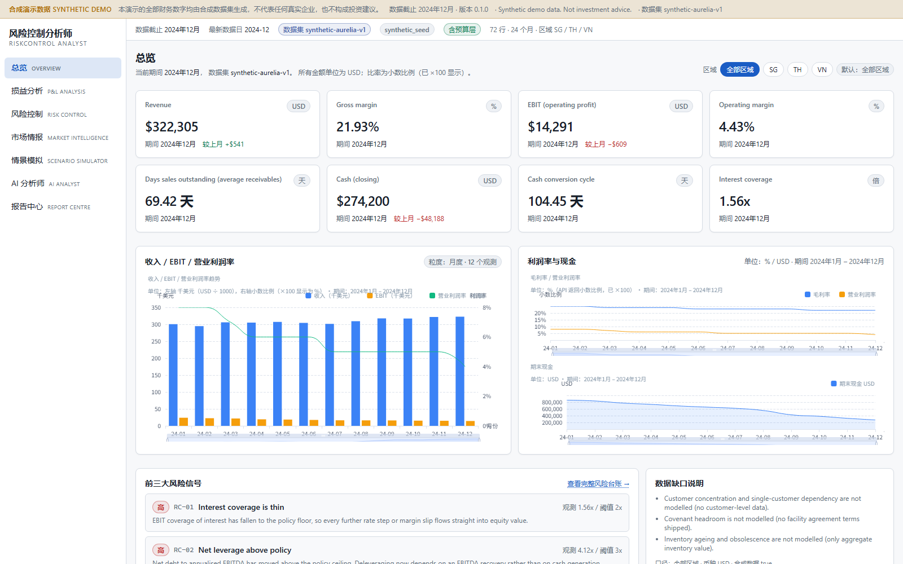

### 风险控制 · Risk control（本项目核心页面）
风险等级仪表盘、严重度筛选，每条信号给出「观测值 / 阈值 / 方向 / 单位 / 建议核查 / 引证来源」。
*The risk register: overall level gauge, severity filters, and per-signal observed value, threshold,
direction, unit, recommended check and citation.*

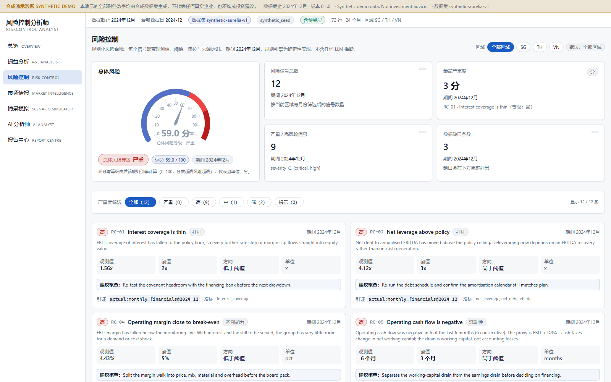

### 损益分析 · P&L analysis
月度损益趋势 + 「实际 vs 预算」差异表，并在界面上明确标注符号约定（成本类差异为负 = 有利）。
*Monthly P&L trends plus an actual-vs-plan variance table with the sign convention stated on screen.*

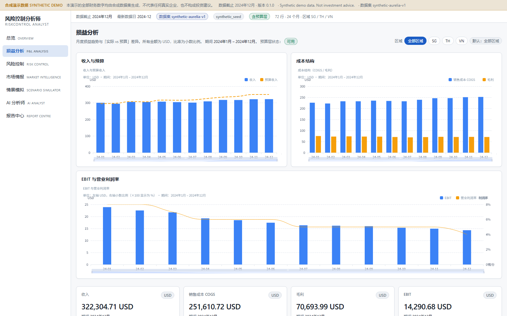

### 市场情报 · Market intelligence
7 条 FRED 序列，**实时观测与本地样本有明确区分**，并显示单位、频率、观察日期与来源链接。
*Seven FRED series with an explicit live-vs-fixture provenance badge, units, frequency, observation
date and source link.*

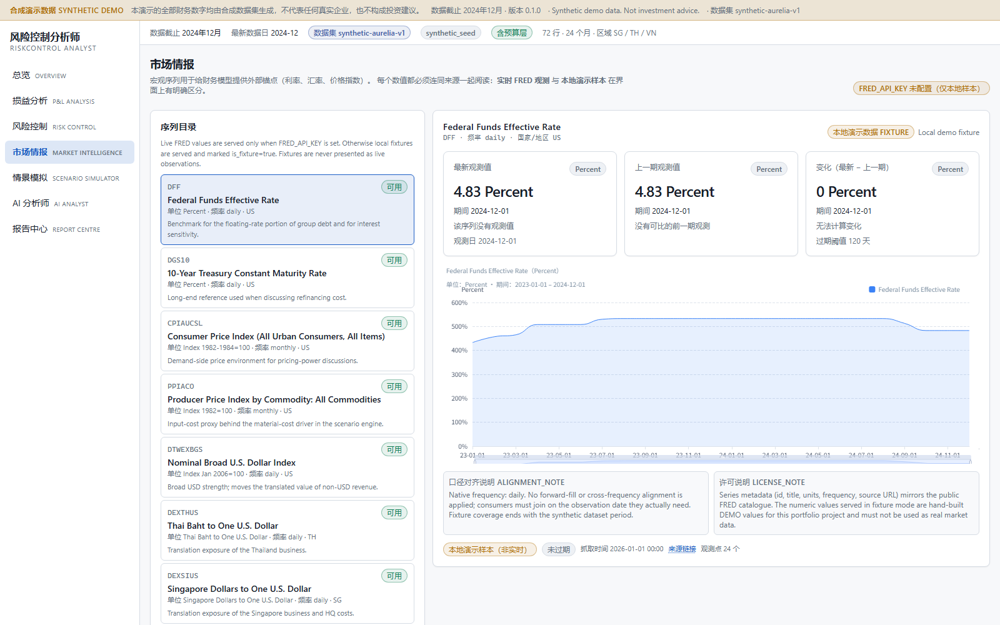

### 情景模拟 · Scenario simulator
11 个驱动因子 → 基准/上行/下行/自定义四情景对比 + 龙卷风敏感性图 + CSV 导出。
*Eleven drivers → base/upside/downside/custom comparison, a tornado sensitivity chart and CSV export.*

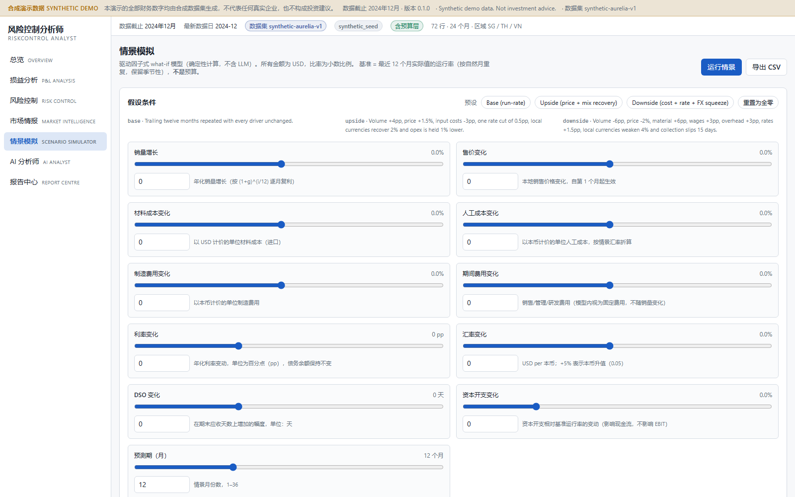

### AI 分析师 · AI analyst
结论、关键发现（每条带引证 chip）、证据表、风险、建议、置信度边界、缺失数据与完整工具调用审计。
*Conclusion, cited key findings, evidence table, risks, recommendations, confidence limits, missing
data and the full tool-call audit.*

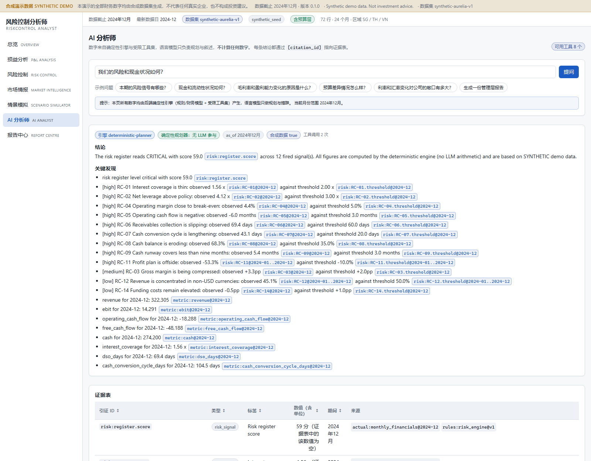

### 报告中心 · Report centre
生成报告后立即显示 7 项核验结果（V-01…V-08）、报告正文与引证列表，可下载 Markdown / HTML。
*After generation: the 7-check verification result, the report body and the citation list, with
Markdown/HTML download.*

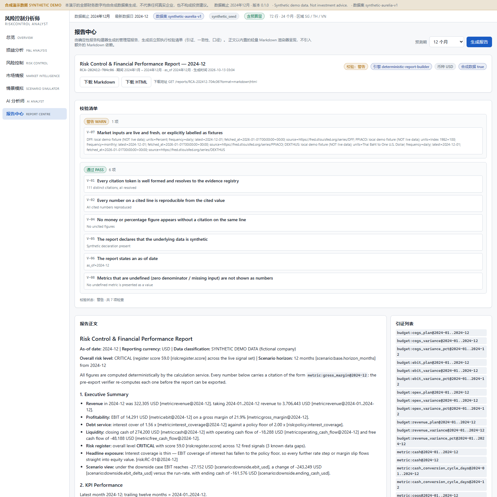

### 导出的报告 · Exported report
同一份报告的 HTML 版本（`docs/samples/report-sample.html`），可直接在浏览器打开。
*The same report as self-contained HTML, openable straight from the repository.*

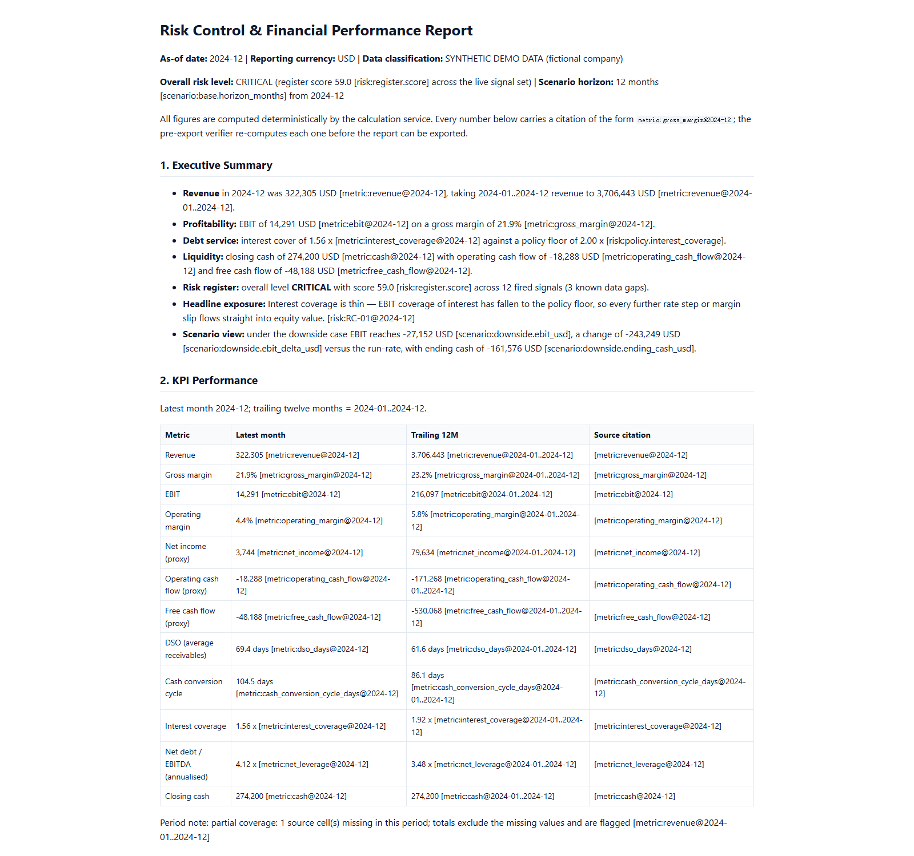

---

## 3. 解决什么问题 · The problem

| 常见痛点 · Pain point | 本项目的做法 · What this project does |
| --- | --- |
| 风险发现太晚，靠月末的 Excel 手工拼<br/>*Risk is spotted late, in a spreadsheet* | 14 条文档化风控规则随数据自动运行，输出带观测值、阈值、严重度与建议核查的台账<br/>*14 documented rules run on every dataset and produce a scored register* |
| 情景测算散落在多个 Excel 副本，口径不明<br/>*Scenario work lives in undocumented copies* | 驱动因子式 What-if 引擎（三预设 + 自定义），模型契约公开、有单调性测试、可导出 CSV<br/>*A driver-based what-if engine with a published contract and monotonicity tests* |
| AI 给出的数字没法审计<br/>*AI answers cannot be audited* | 单一编排器 + 封闭工具集 + 引证守卫：**无法追溯到工具结果的句子会被直接丢弃并说明**<br/>*A citation guard drops any sentence whose figures cannot be traced to a tool result* |
| EBITDA / EBIT / 净利润混用，缺失值被填成 0<br/>*Mixed profit definitions, missing data hidden* | 每个指标带公式、单位、期间、币种与来源 id；缺数据返回 `missing/undefined`，界面显示「不可用」<br/>*Per-metric formula/unit/period/source ids; missing inputs never become 0* |
| 宏观数据来源不明<br/>*Market context without provenance* | 市场适配器：只有配置 key 才取实时 FRED，否则明确标注为本地演示样本<br/>*Live FRED only with a key; otherwise clearly-labelled fixtures* |

**目标用户 · Target users**：中小企业 FP&A 分析师、财务经理/控制人，以及需要一页可信结论的管理层。
*SME FP&A analysts, finance managers/controllers, and management who need one verified page.*

---

## 4. 核心功能 · Features

| 能力 · Capability | 说明 · Detail |
| --- | --- |
| 确定性指标引擎<br/>*Deterministic metrics* | 28 个指标：收入、毛利、EBIT/EBITDA、净利、经营现金流、DSO/DIO/DPO、现金循环周期、利息保障倍数、净负债/EBITDA、流动比率、环比同比、预算差异<br/>*28 metric ids across P&L, cash flow, working capital, coverage, leverage and variances* |
| 风控台账<br/>*Risk register* | 14 条规则 RC-01…RC-14，严重度阶梯、加权评分（0–100）、等级判定，并把「无法评估」显式列为数据缺口<br/>*14 rules with severity ladders, a weighted 0–100 score and explicit data gaps* |
| 情景模拟<br/>*Scenario engine* | 销量、售价、材料、人工、制造费用、期间费用、利率(pp)、汇率、DSO(天)、资本开支、期间长度 → 逐月预测 + 敏感性排序<br/>*Eleven drivers → month-by-month projection plus a ranked tornado* |
| 市场情报<br/>*Market adapter* | 7 条 FRED 序列，带缓存、超时、重试、限流、陈旧标记与实时/样本来源标识<br/>*Seven FRED series with cache, timeout, retry, rate limit, staleness and provenance* |
| AI 分析师<br/>*AI analyst* | 封闭工具集（8 个）+ `extra="forbid"` 参数校验 + 工具调用审计日志 + 引证守卫；**零密钥可运行**<br/>*Closed tool set, strict schemas, audited calls and a citation guard; runs with zero keys* |
| 报告中心<br/>*Report centre* | 8 章节报告，导出前执行 V-01…V-08 核验（引证可解析、数字可复算、无未引用数字、合成声明、as-of、市场新鲜度、零分母）<br/>*Eight sections with 7 pre-export checks* |
| 数据接入<br/>*Data ingestion* | CSV/XLSX 上传：列契约校验、收入恒等式校验、重复行拦截、校验失败不激活；无预算层时明确「无法比较」<br/>*CSV/XLSX upload with contract and identity validation; honest degradation without a plan* |
| 交付闸门<br/>*Delivery gates* | 隐私/密钥扫描脚本（自带 27 个测试，发现问题非零退出）+ 可复现的种子数据生成器<br/>*A tested privacy/secret gate plus a reproducible seed generator* |

---

## 5. 系统架构 · Architecture

### 5.1 数据流 · Data flow

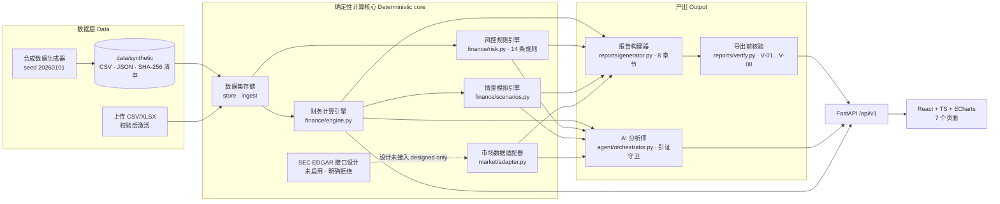

### 5.2 报告生成与核验时序 · Report generation & verification

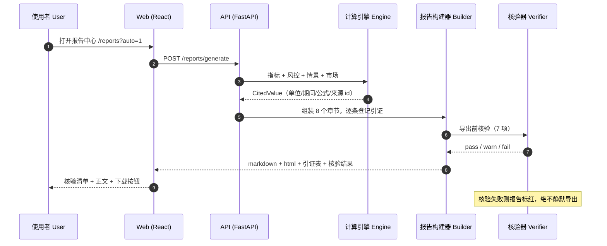

### 5.3 「不让模型编数字」的守卫流程 · Why the model cannot invent a number

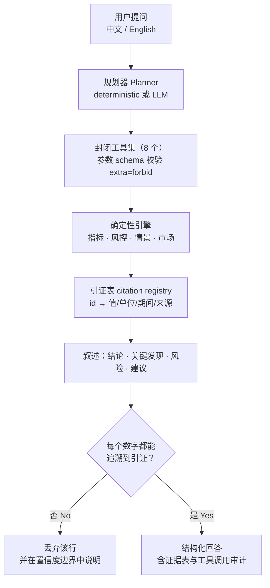

### 5.4 模块边界 · Module boundaries

| 模块 Module | 职责 Responsibility | 绝不允许 Must never |
| --- | --- | --- |
| `services/api/app/finance/` | 指标、风控规则、情景模拟（纯计算，无 I/O） | 调网络、调 LLM、把零分母或缺失值变成数字 |
| `services/api/app/market/` | FRED + 本地样本，来源与新鲜度标注 | 把样本当作实时观测；跨频率盲目对齐 |
| `services/api/app/reports/` | 8 章节组装、引证登记、导出前核验 | 输出未登记的引证；核验失败仍静默导出 |
| `services/api/app/agent/` | 规划、工具调用、叙述、守卫、审计 | 让模型算数、编造引证或绕过工具集 |
| `services/api/app/data/` | 合成数据生成、上传校验、数据集激活 | 隐式修复坏数据；为上传数据编造预算层 |
| `apps/web/` | 渲染 CitedValue、来源徽章、加载/错误/空态 | 在前端计算财务指标；把 `status!="ok"` 渲染成 0 |
| `scripts/check_secrets.py` | 隐私与密钥扫描闸门 | 只当文档存在（它会真的执行并非零退出） |

---

## 6. 关键设计决策 · Key design decisions

1. **算钱的地方没有 AI** — 指标、规则、情景全部是确定性 Python；LLM 只能选工具和写措辞。
   *No AI where money is computed: metrics, rules and scenarios are deterministic Python.*
2. **每个数字都可追溯** — API 中每个值都是 `CitedValue`（单位、期间、公式、来源 id）；报告导出前
   必须通过 7 项核验，否则标记失败。
   *Every number is a `CitedValue` and must pass 7 checks before export.*
3. **缺失就是缺失** — 零分母返回 `undefined`、缺输入返回 `missing`，界面显示「不可用」+ 原因；
   部分覆盖（存在缺失单元格）会显式标注，绝不静默补零。
   *Missing is missing: explicit statuses with reasons, never a silent zero.*
4. **样本数据必须自我暴露** — 没有 FRED key 就返回本地样本，并在 UI、API、报告三处标注；EDGAR
   连接器只做接口设计（`IMPLEMENTED=False`），任何调用都被明确拒绝。
   *Fixtures must announce themselves; the EDGAR connector is designed and refuses to fetch.*
5. **可复现高于漂亮** — 固定种子 + SHA-256 清单 + 确定性引擎，同一条命令永远得到同一份数据。
   *Reproducibility over polish: fixed seed, SHA-256 manifest, deterministic engine.*

---

## 7. 技术栈 · Tech stack

| 层 Layer | 选型 Choices |
| --- | --- |
| 前端 Frontend | React 18 · TypeScript 5.6 (strict) · Vite 5 · Tailwind · ECharts 5 · React Router · Vitest + Testing Library |
| 后端 Backend | Python 3.10+ · FastAPI · Pydantic v2 · pandas · NumPy · httpx · pytest（覆盖率 96%） |
| 数据 Data | 固定种子合成数据（CSV/JSON）· SHA-256 清单 · 上传 CSV/XLSX · 内存数据集存储 |
| 外部数据 External | FRED（可选 key，实时）；SEC EDGAR（接口设计，未启用） |
| 交付 Delivery | Docker Compose（已提供，本机未验证）· `.env.example` · 隐私扫描脚本 |

---

## 8. 快速开始 · Quickstart

### 8.1 后端 · Backend

```bash
python -m pip install -r services/api/requirements.txt
python data/synthetic/generate.py --write      # 生成合成数据（seed 20260101）
python data/synthetic/generate.py --check      # 期望输出 "No issues found."

cd services/api
python -m uvicorn app.main:app --reload --port 8000
# 接口文档 http://127.0.0.1:8000/docs · OpenAPI http://127.0.0.1:8000/openapi.json
```

无需任何密钥即可运行：市场数据回退到明确标注的本地样本，AI 分析师回退到确定性规划器。
*No key required. Copy `.env.example` to `.env` to enable live FRED and/or an LLM planner.*

### 8.2 前端 · Frontend

```bash
cd apps/web
npm install
npm run dev        # http://127.0.0.1:5173 ，/api 自动代理到 8000
```

### 8.3 一键容器 · Docker Compose

```bash
cp .env.example .env      # 可选 optional
docker compose up --build
# web → http://127.0.0.1:5173   api → http://127.0.0.1:8000/docs
```

> 状态：compose 文件与两个 Dockerfile 已提供，但**本机没有 Docker，未执行验证**。
> *Provided but Not Run — Docker was unavailable in the build environment.*

### 8.4 测试 · Tests

```bash
cd services/api && python -m pytest tests -q --cov=app     # 227 passed, coverage 96%

cd apps/web
npm run typecheck && npm test && npm run build             # 69 passed, clean build

# 端到端（真实后端）：先启动 API，再跑实时用例
VITE_API_BASE=http://127.0.0.1:8000/api/v1 npm test
```

---

## 9. API 概览 · API overview

```bash
# 单个指标的完整引证 · one metric with its full citation
curl -s "http://127.0.0.1:8000/api/v1/metrics?month=2024-12" | jq '.values.revenue'
# { "metric_id":"revenue","value":322304.71,"unit":"USD","period":"2024-12",
#   "formula":"sum(revenue_usd)","source_ids":["actual:monthly_financials@2024-12"],
#   "status":"ok","synthetic":true }

# 风控台账 · the risk register
curl -s "http://127.0.0.1:8000/api/v1/risk/register" | jq '{level:.overall_level,score,signals:(.signals|length)}'
# { "level":"critical", "score":59.0, "signals":12 }

# 问 AI 分析师（零密钥也可用）· ask the analyst (no key needed)
curl -s -X POST "http://127.0.0.1:8000/api/v1/agent/ask" -H "Content-Type: application/json" \
  -d '{"question":"我们的风险和现金状况如何？","month":"2024-12"}' | jq '.key_findings[0:2]'

# 生成报告并查看核验结果 · generate a report and read its verification
curl -s -X POST "http://127.0.0.1:8000/api/v1/reports/generate" -H "Content-Type: application/json" \
  -d '{"horizon_months":12}' | jq '{id:.report_id, status:.verification_status}'
```

完整契约见 [`docs/api-contract.md`](docs/api-contract.md)，真实响应样例见
[`docs/samples/`](docs/samples/)。*Full contract and captured responses are in `docs/`.*

---

## 10. 质量与测试 · Quality & tests

| 检查 Check | 结果 Result |
| --- | --- |
| `pytest`（后端） | **227 个测试全部通过**，语句覆盖率 **96%**（2925 语句 / 113 未覆盖） |
| `vitest`（前端） | **69 个测试全部通过**（8 个文件），含**对真实后端**的 7 页面遍历与深链接用例 |
| `tsc --noEmit` | 无类型错误（strict 模式） |
| `vite build` | 608 模块，JS 约 797 kB（gzip 约 266 kB），CSS 约 19.4 kB |
| Agent 评测集 | **22/22 通过**：常规、缺数据、矛盾前提、零分母、单位/汇率、提示注入、API 故障 |
| 导出前核验 | V-01 111/111 引证可解析 · V-02 数字可复算 · V-04 无未引用数字 · V-05 合成声明 · V-06 as-of · V-07 样本数据告警（设计如此）· V-08 零分母不显示为数字 |
| 隐私/密钥扫描 | `python scripts/check_secrets.py` → **clean**（135 个文件，扫描器自身有 27 个测试） |
| 端到端 | `docs/samples/` 内的报告、接口响应与 UI 渲染快照均为真实运行产物 |

**未执行项（诚实声明）· Not Run**：Docker Compose（本机无 Docker）、Playwright 真实浏览器用例、
真实 FRED 实时拉取与真实 LLM 调用（无 key，已用 MockTransport / StubLLMClient 覆盖代码路径）。
*See [`docs/test-report.md`](docs/test-report.md) for the full Pass / Not Run table.*

---

## 11. 数据与合成声明 · Data & synthetic declaration

| 数据 Data | 内容 Content | 标注 Labelling |
| --- | --- | --- |
| 企业财务<br/>*Company financials* | 虚构东南亚消费品集团，24 个月（2023-01…2024-12）× 3 区域（SG/TH/VN），种子 `20260101` | 所有响应的 `synthetic: true`；含 1 处**故意缺失**的单元格用于演示部分覆盖 |
| 宏观市场<br/>*Macro market* | 7 条 FRED 序列 id + 人工构造的演示数值 | `is_fixture: true`、`source_name: "Local demo fixture"`，界面/报告/API 三处显示「非实时」 |
| 实时 FRED<br/>*Live FRED* | 仅当配置 `FRED_API_KEY` | `is_fixture: false`；超过 120 天未更新标记 `is_stale` |
| 上传数据<br/>*Uploads* | 使用者自行上传的 CSV/XLSX | `synthetic: false`；无预算层时预算差异明确返回「不可用」 |

字段字典见 [`docs/data-dictionary.md`](docs/data-dictionary.md)，公式与口径见
[`docs/financial-methodology.md`](docs/financial-methodology.md)。

---

## 12. 局限与路线图 · Limitations & roadmap

**已知局限 · Known limitations**

- 数据全部为合成数据，且刻意设计了下行情景，**不代表任何真实企业**。
- 情景模型是线性的、契约公开的：无需求弹性、无机器学习、期间费用视为固定、债务不新增。
- 宏观数据默认是本地样本；EDGAR 只设计了接口，未接入。
- 预算只有集团层，没有区域拆分；未建模客户集中度、契约条款空间、存货账龄与税务计算。
- 无鉴权、单进程状态、无真实浏览器端到端测试。

**路线图 · Roadmap**

| 优先级 Priority | 内容 Scope |
| --- | --- |
| P0 已完成 Delivered | 合成数据 + 校验、指标引擎、风控台账、情景引擎、市场适配器、EDGAR 接口设计、报告 + 核验、AI 分析师 + 守卫、REST API、7 页前端、隐私扫描闸门、296 个测试 |
| P1 | Playwright 端到端与截图流水线 · PDF 导出 · 上传预校验（dry-run）· 前端分包（当前 JS 797 kB）· Docker Compose 在 CI 验证 · 区域预算层 |
| P2 | 鉴权与角色 · PostgreSQL 持久化 · 契约条款排程 · 客户集中度 · 存货账龄 · 更多情景驱动因子 · EDGAR 真正接入 |

完整验收标准见 [`docs/roadmap.md`](docs/roadmap.md)。

---

## 13. 文档索引 · Documentation

| 文档 Document | 内容 Contents |
| --- | --- |
| [`docs/PRD.md`](docs/PRD.md) | 产品定位、非目标、用户画像、界面清单、字段字典、异常状态、成功指标 |
| [`docs/user-flows.md`](docs/user-flows.md) | 用户旅程：每步调用的接口、失败分支与产出物 |
| [`docs/architecture.md`](docs/architecture.md) | 数据流、模块边界（含「绝不能做」）、确定性执行点、取舍记录 |
| [`docs/api-contract.md`](docs/api-contract.md) | 全部接口、请求/响应字段、错误码与前端约定 |
| [`docs/financial-methodology.md`](docs/financial-methodology.md) | 公式、单位、期间口径、EBITDA/EBIT/净利区分、缺失与零分母策略 |
| [`docs/data-dictionary.md`](docs/data-dictionary.md) | 逐字段契约、故意缺失值、上传规则、生成器驱动曲线 |
| [`docs/risk-rules.md`](docs/risk-rules.md) | RC-01…RC-14 阈值与严重度阶梯、评分公式、声明式未覆盖项 |
| [`docs/market-data-sources.md`](docs/market-data-sources.md) | FRED 序列、实时/样本规则、缓存重试限流、EDGAR 接口设计 |
| [`docs/agent-design.md`](docs/agent-design.md) | 工具集、守卫机制、两种运行模式、回答结构、明确不做的事 |
| [`docs/evaluation.md`](docs/evaluation.md) | 测试清单与覆盖率、22 个评测用例、未覆盖项说明 |
| [`docs/test-report.md`](docs/test-report.md) | 验收清单、实际执行命令与结果、Not Run 列表、缺陷修复记录 |
| [`docs/roadmap.md`](docs/roadmap.md) | P0/P1/P2 待办、已知限制、风险登记、开放问题 |

---

## 14. 许可 · License

MIT — 见 [`LICENSE`](LICENSE)。许可声明中再次说明：**仓库内全部数据均为虚构的演示数据**。
*MIT. The licence notice restates that every shipped figure is fictional demo data.*
