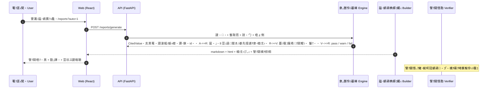

# 鬟朱勦謗ｧ蛻ｶ蛻・梵蟶・ﾂｷ RiskControl Analyst

**髱｢蜷台ｸｭ蟆丈ｼ∽ｸ夊ｴ｢蜉｡蝗｢髦溽噪鬟朱勦謗ｧ蛻ｶ荳守ｻ剰是蜀ｳ遲匁匱閭ｽ蟷ｳ蜿ｰ・亥庄霑占｡・Demo・・*
*A working demo of a risk-control & FP&A decision-intelligence platform for SMEs.*

[](services/api)
[](services/api)
[](apps/web)
[](apps/web)
[](docs/evaluation.md)
[](LICENSE)
[](#11-謨ｰ謐ｮ荳主粋謌仙｣ｰ譏・-data--synthetic-declaration)

> 笞・・**譛ｬ莉灘ｺ灘・驛ｨ謨ｰ蟄怜插荳ｺ蜷域・貍皮､ｺ謨ｰ謐ｮ縲・* 莨∽ｸ壻ｸｺ陌壽桷逧・ｸ懷漉莠壽ｶ郁ｴｹ蜩・寔蝗｢・・urelia Consumer Goods
> Pte. Ltd.・会ｼ悟ｮ剰ｧよ焚謐ｮ荳ｺ莠ｺ蟾･譫・€逧・ｼ皮､ｺ譬ｷ譛ｬ閠碁撼螳樊慮陦梧ュ縲・> *All figures are SYNTHETIC demo data. The company is fictional; the macro values are hand-built
> fixtures, not live market observations. Nothing here is investment advice.*

---

## 逶ｮ蠖・ﾂｷ Table of contents

| # | 遶闃・| Section |
| --- | --- | --- |
| 1 | [荳€蜿･隸昜ｻ狗ｻ江(#1-荳€蜿･隸昜ｻ狗ｻ・-one-liner) | One-liner |
| 2 | [逡碁擇鬚・ｧ・(#2-逡碁擇鬚・ｧ・-screenshots) | Screenshots |
| 3 | [隗｣蜀ｳ莉€荵磯琉鬚肋(#3-隗｣蜀ｳ莉€荵磯琉鬚・-the-problem) | The problem |
| 4 | [譬ｸ蠢・粥閭ｽ](#4-譬ｸ蠢・粥閭ｽ--features) | Features |
| 5 | [邉ｻ扈滓楔譫Ь(#5-邉ｻ扈滓楔譫・-architecture) | Architecture |
| 6 | [蜈ｳ髞ｮ隶ｾ隶｡蜀ｳ遲望(#6-蜈ｳ髞ｮ隶ｾ隶｡蜀ｳ遲・-key-design-decisions) | Key design decisions |
| 7 | [謚€譛ｯ譬・(#7-謚€譛ｯ譬・-tech-stack) | Tech stack |
| 8 | [蠢ｫ騾溷ｼ€蟋犠(#8-蠢ｫ騾溷ｼ€蟋・-quickstart) | Quickstart |
| 9 | [API 讎りｧ・(#9-api-讎りｧ・-api-overview) | API overview |
| 10 | [雍ｨ驥丈ｸ取ｵ玖ｯ評(#10-雍ｨ驥丈ｸ取ｵ玖ｯ・-quality--tests) | Quality & tests |
| 11 | [謨ｰ謐ｮ荳主粋謌仙｣ｰ譏讃(#11-謨ｰ謐ｮ荳主粋謌仙｣ｰ譏・-data--synthetic-declaration) | Data & synthetic declaration |
| 12 | [螻€髯蝉ｸ手ｷｯ郤ｿ蝗ｾ](#12-螻€髯蝉ｸ手ｷｯ郤ｿ蝗ｾ--limitations--roadmap) | Limitations & roadmap |
| 13 | [譁・｡｣邏｢蠑評(#13-譁・｡｣邏｢蠑・-documentation) | Documentation |

---

## 1. 荳€蜿･隸昜ｻ狗ｻ・ﾂｷ One-liner

**荳ｭ譁・*・壽滑縲悟ｯｼ蜈･扈剰是謨ｰ謐ｮ 竊・隶｡邂苓ｴ｢蜉｡荳朱｣朱勦謖・・竊・讓｡諡・What-if 諠・勹 竊・逕滓・蜿ｯ霑ｽ貅ｯ逧・ｮ｡逅・ｱよ冠蜻翫€崎ｿ・譚｡髣ｭ邇ｯ蛛壽・荳€荳ｪ閭ｽ霍題ｵｷ譚･逧・ｳｻ扈滂ｼ・*謇€譛画焚蟄鈴・逕ｱ遑ｮ螳壽€ｧ莉｣遐∬ｮ｡邂怜ｹｶ蟶ｦ譚･貅仙ｼ戊ｯ・ｼ瑚ｯｭ險€讓｡蝙句宵雍溯ｴ｣隗・・荳主徐霑ｰ・・扈昜ｸ榊盾荳守ｮ玲焚**縲・
**English**: An end-to-end loop 窶・import operating data 竊・compute financial & risk metrics 竊・run
what-if scenarios 竊・export a traceable management report. Every number is produced by deterministic
code and carries a citation; the LLM plans and narrates but **never computes**.

| 荳€逵ｼ逵区№ | At a glance |
| --- | --- |
| 蜷守ｫｯ・哥astAPI + pandas・・8 荳ｪ謖・・€・4 譚｡鬟取而隗・・縲・1 荳ｪ諠・勹鬩ｱ蜉ｨ蝗蟄・| Backend: FastAPI + pandas 窶・28 metrics, 14 risk rules, 11 scenario drivers |
| 蜑咲ｫｯ・啌eact + TypeScript + Vite + Tailwind + ECharts・・ 荳ｪ荳ｭ譁・｡ｵ髱｢ | Frontend: React + TS + Vite + Tailwind + ECharts, 7 pages |
| 雍ｨ驥擾ｼ・96 荳ｪ閾ｪ蜉ｨ蛹匁ｵ玖ｯ包ｼ・27 蜷守ｫｯ + 69 蜑咲ｫｯ・会ｼ悟錘遶ｯ隕・尠邇・96% | Quality: 296 automated tests (227 backend + 69 frontend), 96% backend coverage |
| 蜷郁ｧ・ｼ壽冠蜻雁ｯｼ蜃ｺ蜑肴鴬陦・7 鬘ｹ譬ｸ鬪鯉ｼ檎ｼｺ謨ｰ謐ｮ荳€蠕区仞遉ｺ縲御ｸ榊庄逕ｨ縲崎€碁撼 0 | Compliance: 7 pre-export checks; missing data renders as "unavailable", never 0 |
| 謨ｰ謐ｮ・壼崋螳夂ｧ榊ｭ千函謌千噪蜷域・謨ｰ謐ｮ・郡HA-256 貂・黒蜿ｯ螟咲鴫 | Data: fixed-seed synthetic dataset with a SHA-256 manifest |

---

## 2. 逡碁擇鬚・ｧ・ﾂｷ Screenshots

> 莉･荳区穐蝗ｾ蜿冶・譛ｬ譛ｺ逵溷ｮ櫁ｿ占｡檎噪蜑榊錘遶ｯ・域裏螟ｴ豬剰ｧ亥勣謚灘叙・会ｼ碁撼遉ｺ諢丞崟縲・> *Captured from the actually running app with a headless browser 窶・not mockups.*

### 諤ｻ隗・ﾂｷ Overview
8 蠑 KPI 蜊｡ + 蜿瑚ｽｴ雜句漢蝗ｾ + 蜑堺ｸ牙､ｧ鬟朱勦菫｡蜿ｷ + 謨ｰ謐ｮ郛ｺ蜿｣隸ｴ譏弱€・*Eight KPI cards, dual-axis trend charts, top-3 risk signals and an explicit data-gap panel.*


### 鬟朱勦謗ｧ蛻ｶ ﾂｷ Risk control・域悽鬘ｹ逶ｮ譬ｸ蠢・｡ｵ髱｢・・鬟朱勦遲臥ｺｧ莉ｪ陦ｨ逶倥€∽ｸ･驥榊ｺｦ遲幃€会ｼ梧ｯ乗擅菫｡蜿ｷ扈吝・縲瑚ｧよｵ句€ｼ / 髦亥€ｼ / 譁ｹ蜷・/ 蜊穂ｽ・/ 蟒ｺ隶ｮ譬ｸ譟･ / 蠑戊ｯ∵擂貅舌€阪€・*The risk register: overall level gauge, severity filters, and per-signal observed value, threshold,
direction, unit, recommended check and citation.*


### 謐溽寢蛻・梵 ﾂｷ P&L analysis
譛亥ｺｦ謐溽寢雜句漢 + 縲悟ｮ樣刔 vs 鬚・ｮ励€榊ｷｮ蠑り｡ｨ・悟ｹｶ蝨ｨ逡碁擇荳頑・遑ｮ譬・ｳｨ隨ｦ蜿ｷ郤ｦ螳夲ｼ域・譛ｬ邀ｻ蟾ｮ蠑ゆｸｺ雍・= 譛牙茜・峨€・*Monthly P&L trends plus an actual-vs-plan variance table with the sign convention stated on screen.*


### 蟶ょ惻諠・冠 ﾂｷ Market intelligence
7 譚｡ FRED 蠎丞・・・*螳樊慮隗よｵ倶ｸ取悽蝨ｰ譬ｷ譛ｬ譛画・遑ｮ蛹ｺ蛻・*・悟ｹｶ譏ｾ遉ｺ蜊穂ｽ阪€・｢醍紫縲∬ｧょｯ滓律譛滉ｸ取擂貅宣得謗･縲・*Seven FRED series with an explicit live-vs-fixture provenance badge, units, frequency, observation
date and source link.*


### 諠・勹讓｡諡・ﾂｷ Scenario simulator
11 荳ｪ鬩ｱ蜉ｨ蝗蟄・竊・蝓ｺ蜃・荳願｡・荳玖｡・閾ｪ螳壻ｹ牙屁諠・勹蟇ｹ豈・+ 鮴吝差鬟取撫諢滓€ｧ蝗ｾ + CSV 蟇ｼ蜃ｺ縲・*Eleven drivers 竊・base/upside/downside/custom comparison, a tornado sensitivity chart and CSV export.*


### AI 蛻・梵蟶・ﾂｷ AI analyst
扈楢ｮｺ縲∝・髞ｮ蜿醍鴫・域ｯ乗擅蟶ｦ蠑戊ｯ・chip・峨€∬ｯ∵紺陦ｨ縲・｣朱勦縲∝ｻｺ隶ｮ縲∫ｽｮ菫｡蠎ｦ霎ｹ逡後€∫ｼｺ螟ｱ謨ｰ謐ｮ荳主ｮ梧紛蟾･蜈ｷ隹・畑螳｡隶｡縲・*Conclusion, cited key findings, evidence table, risks, recommendations, confidence limits, missing
data and the full tool-call audit.*


### 謚･蜻贋ｸｭ蠢・ﾂｷ Report centre
逕滓・謚･蜻雁錘遶句叉譏ｾ遉ｺ 7 鬘ｹ譬ｸ鬪檎ｻ捺棡・・-01窶ｦV-08・峨€∵冠蜻頑ｭ｣譁・ｸ主ｼ戊ｯ∝・陦ｨ・悟庄荳玖ｽｽ Markdown / HTML縲・*After generation: the 7-check verification result, the report body and the citation list, with
Markdown/HTML download.*


### 蟇ｼ蜃ｺ逧・冠蜻・ﾂｷ Exported report
蜷御ｸ€莉ｽ謚･蜻顔噪 HTML 迚域悽・・docs/samples/report-sample.html`・会ｼ悟庄逶ｴ謗･蝨ｨ豬剰ｧ亥勣謇灘ｼ€縲・*The same report as self-contained HTML, openable straight from the repository.*


---

## 3. 隗｣蜀ｳ莉€荵磯琉鬚・ﾂｷ The problem

| 蟶ｸ隗∫李轤ｹ ﾂｷ Pain point | 譛ｬ鬘ｹ逶ｮ逧・★豕・ﾂｷ What this project does |
| --- | --- |
| 鬟朱勦蜿醍鴫螟ｪ譎夲ｼ碁擒譛域忰逧・Excel 謇句ｷ･諡ｼ<br/>*Risk is spotted late, in a spreadsheet* | 14 譚｡譁・｡｣蛹夜｣取而隗・・髫乗焚謐ｮ閾ｪ蜉ｨ霑占｡鯉ｼ瑚ｾ灘・蟶ｦ隗よｵ句€ｼ縲・・蛟ｼ縲∽ｸ･驥榊ｺｦ荳主ｻｺ隶ｮ譬ｸ譟･逧・床雍ｦ<br/>*14 documented rules run on every dataset and produce a scored register* |
| 諠・勹豬狗ｮ玲淵關ｽ蝨ｨ螟壻ｸｪ Excel 蜑ｯ譛ｬ・悟哨蠕・ｸ肴・<br/>*Scenario work lives in undocumented copies* | 鬩ｱ蜉ｨ蝗蟄仙ｼ・What-if 蠑墓梼・井ｸ蛾｢・ｮｾ + 閾ｪ螳壻ｹ会ｼ会ｼ梧ｨ｡蝙句･醍ｺｦ蜈ｬ蠑€縲∵怏蜊戊ｰ・€ｧ豬玖ｯ輔€∝庄蟇ｼ蜃ｺ CSV<br/>*A driver-based what-if engine with a published contract and monotonicity tests* |
| AI 扈吝・逧・焚蟄玲ｲ｡豕募ｮ｡隶｡<br/>*AI answers cannot be audited* | 蜊穂ｸ€郛匁賜蝎ｨ + 蟆・溜蟾･蜈ｷ髮・+ 蠑戊ｯ∝ｮ亥梱・・*譌豕戊ｿｽ貅ｯ蛻ｰ蟾･蜈ｷ扈捺棡逧・唱蟄蝉ｼ夊｢ｫ逶ｴ謗･荳｢蠑・ｹｶ隸ｴ譏・*<br/>*A citation guard drops any sentence whose figures cannot be traced to a tool result* |
| EBITDA / EBIT / 蜃€蛻ｩ豸ｦ豺ｷ逕ｨ・檎ｼｺ螟ｱ蛟ｼ陲ｫ蝪ｫ謌・0<br/>*Mixed profit definitions, missing data hidden* | 豈丈ｸｪ謖・・ｸｦ蜈ｬ蠑上€∝黒菴阪€∵悄髣ｴ縲∝ｸ∫ｧ堺ｸ取擂貅・id・帷ｼｺ謨ｰ謐ｮ霑泌屓 `missing/undefined`・檎阜髱｢譏ｾ遉ｺ縲御ｸ榊庄逕ｨ縲・br/>*Per-metric formula/unit/period/source ids; missing inputs never become 0* |
| 螳剰ｧよ焚謐ｮ譚･貅蝉ｸ肴・<br/>*Market context without provenance* | 蟶ょ惻騾る・蝎ｨ・壼宵譛蛾・鄂ｮ key 謇榊叙螳樊慮 FRED・悟凄蛻呎・遑ｮ譬・ｳｨ荳ｺ譛ｬ蝨ｰ貍皮､ｺ譬ｷ譛ｬ<br/>*Live FRED only with a key; otherwise clearly-labelled fixtures* |

**逶ｮ譬・畑謌ｷ ﾂｷ Target users**・壻ｸｭ蟆丈ｼ∽ｸ・FP&A 蛻・梵蟶医€∬ｴ｢蜉｡扈冗炊/謗ｧ蛻ｶ莠ｺ・御ｻ･蜿企怙隕∽ｸ€鬘ｵ蜿ｯ菫｡扈楢ｮｺ逧・ｮ｡逅・ｱゅ€・*SME FP&A analysts, finance managers/controllers, and management who need one verified page.*

---

## 4. 譬ｸ蠢・粥閭ｽ ﾂｷ Features

| 閭ｽ蜉・ﾂｷ Capability | 隸ｴ譏・ﾂｷ Detail |
| --- | --- |
| 遑ｮ螳壽€ｧ謖・・ｼ墓梼<br/>*Deterministic metrics* | 28 荳ｪ謖・・ｼ壽噺蜈･縲∵ｯ帛茜縲・BIT/EBITDA縲∝〝蛻ｩ縲∫ｻ剰是邇ｰ驥第ｵ√€．SO/DIO/DPO縲∫鴫驥大ｾｪ邇ｯ蜻ｨ譛溘€∝茜諱ｯ菫晞囿蛟肴焚縲∝〝雍溷€ｺ/EBITDA縲∵ｵ∝勘豈皮紫縲∫識豈泌酔豈斐€・｢・ｮ怜ｷｮ蠑・br/>*28 metric ids across P&L, cash flow, working capital, coverage, leverage and variances* |
| 鬟取而蜿ｰ雍ｦ<br/>*Risk register* | 14 譚｡隗・・ RC-01窶ｦRC-14・御ｸ･驥榊ｺｦ髦ｶ譴ｯ縲∝刈譚・ｯ・・・・窶・00・峨€∫ｭ臥ｺｧ蛻､螳夲ｼ悟ｹｶ謚翫€梧裏豕戊ｯ・ｼｰ縲肴仞蠑丞・荳ｺ謨ｰ謐ｮ郛ｺ蜿｣<br/>*14 rules with severity ladders, a weighted 0窶・00 score and explicit data gaps* |
| 諠・勹讓｡諡・br/>*Scenario engine* | 髞€驥上€∝醗莉ｷ縲∵攝譁吶€∽ｺｺ蟾･縲∝宛騾雍ｹ逕ｨ縲∵悄髣ｴ雍ｹ逕ｨ縲∝茜邇・pp)縲∵ｱ・紫縲．SO(螟ｩ)縲∬ｵ・悽蠑€謾ｯ縲∵悄髣ｴ髟ｿ蠎ｦ 竊・騾先怦鬚・ｵ・+ 謨乗─諤ｧ謗貞ｺ・br/>*Eleven drivers 竊・month-by-month projection plus a ranked tornado* |
| 蟶ょ惻諠・冠<br/>*Market adapter* | 7 譚｡ FRED 蠎丞・・悟ｸｦ郛灘ｭ倥€∬ｶ・慮縲・㍾隸輔€・剞豬√€・刪譌ｧ譬・ｮｰ荳主ｮ樊慮/譬ｷ譛ｬ譚･貅先・ｯ・br/>*Seven FRED series with cache, timeout, retry, rate limit, staleness and provenance* |
| AI 蛻・梵蟶・br/>*AI analyst* | 蟆・溜蟾･蜈ｷ髮・ｼ・ 荳ｪ・・ `extra="forbid"` 蜿よ焚譬｡鬪・+ 蟾･蜈ｷ隹・畑螳｡隶｡譌･蠢・+ 蠑戊ｯ∝ｮ亥梱・・*髮ｶ蟇・徴蜿ｯ霑占｡・*<br/>*Closed tool set, strict schemas, audited calls and a citation guard; runs with zero keys* |
| 謚･蜻贋ｸｭ蠢・br/>*Report centre* | 8 遶闃よ冠蜻奇ｼ悟ｯｼ蜃ｺ蜑肴鴬陦・V-01窶ｦV-08 譬ｸ鬪鯉ｼ亥ｼ戊ｯ∝庄隗｣譫舌€∵焚蟄怜庄螟咲ｮ励€∵裏譛ｪ蠑慕畑謨ｰ蟄励€∝粋謌仙｣ｰ譏弱€∥s-of縲∝ｸょ惻譁ｰ魎懷ｺｦ縲・峺蛻・ｯ搾ｼ・br/>*Eight sections with 7 pre-export checks* |
| 謨ｰ謐ｮ謗･蜈･<br/>*Data ingestion* | CSV/XLSX 荳贋ｼ・壼・螂醍ｺｦ譬｡鬪後€∵噺蜈･諱堤ｭ牙ｼ乗｡鬪後€・㍾螟崎｡梧協謌ｪ縲∵｡鬪悟､ｱ雍･荳肴ｿ€豢ｻ・帶裏鬚・ｮ怜ｱよ慮譏守｡ｮ縲梧裏豕墓ｯ碑ｾ・€・br/>*CSV/XLSX upload with contract and identity validation; honest degradation without a plan* |
| 莠､莉倬虜髣ｨ<br/>*Delivery gates* | 髫千ｧ・蟇・徴謇ｫ謠剰・譛ｬ・郁・蟶ｦ 27 荳ｪ豬玖ｯ包ｼ悟書邇ｰ髣ｮ鬚倬撼髮ｶ騾€蜃ｺ・・ 蜿ｯ螟咲鴫逧・ｧ榊ｭ先焚謐ｮ逕滓・蝎ｨ<br/>*A tested privacy/secret gate plus a reproducible seed generator* |

---

## 5. 邉ｻ扈滓楔譫・ﾂｷ Architecture

### 5.1 謨ｰ謐ｮ豬・ﾂｷ Data flow

```mermaid
flowchart LR
    subgraph DATA["謨ｰ謐ｮ螻・Data"]
        G["蜷域・謨ｰ謐ｮ逕滓・蝎ｨ<br/>seed 20260101"]
        CSV[("data/synthetic<br/>CSV ﾂｷ JSON ﾂｷ SHA-256 貂・黒")]
        UP["荳贋ｼ CSV/XLSX<br/>譬｡鬪悟錘豼€豢ｻ"]
    end

    subgraph CORE["遑ｮ螳壽€ｧ隶｡邂玲ｸ蠢・Deterministic core"]
        ST["謨ｰ謐ｮ髮・ｭ伜お<br/>store ﾂｷ ingest"]
        EN["雍｢蜉｡隶｡邂怜ｼ墓梼<br/>finance/engine.py"]
        RK["鬟取而隗・・蠑墓梼<br/>finance/risk.py ﾂｷ 14 譚｡隗・・"]
        SC["諠・勹讓｡諡溷ｼ墓梼<br/>finance/scenarios.py"]
        MK["蟶ょ惻謨ｰ謐ｮ騾る・蝎ｨ<br/>market/adapter.py"]
        ED["SEC EDGAR 謗･蜿｣隶ｾ隶｡<br/>譛ｪ蜷ｯ逕ｨ ﾂｷ 譏守｡ｮ諡堤ｻ・]
    end

    subgraph OUT["莠ｧ蜃ｺ Output"]
        RP["謚･蜻頑桷蟒ｺ蝎ｨ<br/>reports/generator.py ﾂｷ 8 遶闃・]
        VF["蟇ｼ蜃ｺ蜑肴ｸ鬪・br/>reports/verify.py ﾂｷ V-01窶ｦV-08"]
        AG["AI 蛻・梵蟶・br/>agent/orchestrator.py ﾂｷ 蠑戊ｯ∝ｮ亥梱"]
    end

    API["FastAPI /api/v1"]
    WEB["React + TS + ECharts<br/>7 荳ｪ鬘ｵ髱｢"]

    G --> CSV --> ST
    UP --> ST
    ST --> EN
    ST --> RK
    EN --> SC
    EN --> RP
    RK --> RP
    SC --> RP
    MK --> RP
    ED -.->|隶ｾ隶｡譛ｪ謗･蜈･ designed only| MK
    RP --> VF
    EN --> AG
    RK --> AG
    SC --> AG
    MK --> AG
    VF --> API
    AG --> API
    EN --> API
    API --> WEB
```

### 5.2 謚･蜻顔函謌蝉ｸ取ｸ鬪梧慮蠎・ﾂｷ Report generation & verification



### 5.3 縲御ｸ崎ｮｩ讓｡蝙狗ｼ匁焚蟄励€咲噪螳亥梱豬∫ｨ・ﾂｷ Why the model cannot invent a number

```mermaid
flowchart TD
    Q["逕ｨ謌ｷ謠宣琉<br/>荳ｭ譁・/ English"] --> P["隗・・蝎ｨ Planner<br/>deterministic 謌・LLM"]
    P --> T["蟆・溜蟾･蜈ｷ髮・ｼ・ 荳ｪ・・br/>蜿よ焚 schema 譬｡鬪・extra=forbid"]
    T --> E["遑ｮ螳壽€ｧ蠑墓梼<br/>謖・・ﾂｷ 鬟取而 ﾂｷ 諠・勹 ﾂｷ 蟶ょ惻"]
    E --> C["蠑戊ｯ∬｡ｨ citation registry<br/>id 竊・蛟ｼ/蜊穂ｽ・譛滄龍/譚･貅・]
    C --> N["蜿呵ｿｰ・夂ｻ楢ｮｺ ﾂｷ 蜈ｳ髞ｮ蜿醍鴫 ﾂｷ 鬟朱勦 ﾂｷ 蟒ｺ隶ｮ"]
    N --> GD{"豈丈ｸｪ謨ｰ蟄鈴・閭ｽ<br/>霑ｽ貅ｯ蛻ｰ蠑戊ｯ・ｼ・}
    GD -- 蜷ｦ No --> X["荳｢蠑・ｯ･陦・br/>蟷ｶ蝨ｨ鄂ｮ菫｡蠎ｦ霎ｹ逡御ｸｭ隸ｴ譏・]
    GD -- 譏ｯ Yes --> OUT["扈捺桷蛹門屓遲・br/>蜷ｫ隸∵紺陦ｨ荳主ｷ･蜈ｷ隹・畑螳｡隶｡"]
```

### 5.4 讓｡蝮苓ｾｹ逡・ﾂｷ Module boundaries

| 讓｡蝮・Module | 閨瑚ｴ｣ Responsibility | 扈昜ｸ榊・隶ｸ Must never |
| --- | --- | --- |
| `services/api/app/finance/` | 謖・・€・｣取而隗・・縲∵ュ譎ｯ讓｡諡滂ｼ育ｺｯ隶｡邂暦ｼ梧裏 I/O・・| 隹・ｽ醍ｻ懊€∬ｰ・LLM縲∵滑髮ｶ蛻・ｯ肴・郛ｺ螟ｱ蛟ｼ蜿俶・謨ｰ蟄・|
| `services/api/app/market/` | FRED + 譛ｬ蝨ｰ譬ｷ譛ｬ・梧擂貅蝉ｸ取眠魎懷ｺｦ譬・ｳｨ | 謚頑ｷ譛ｬ蠖謎ｽ懷ｮ樊慮隗よｵ具ｼ幄ｷｨ鬚醍紫逶ｲ逶ｮ蟇ｹ鮨・|
| `services/api/app/reports/` | 8 遶闃らｻ・｣・€∝ｼ戊ｯ∫匳隶ｰ縲∝ｯｼ蜃ｺ蜑肴ｸ鬪・| 霎灘・譛ｪ逋ｻ隶ｰ逧・ｼ戊ｯ・ｼ帶ｸ鬪悟､ｱ雍･莉埼撕鮟伜ｯｼ蜃ｺ |
| `services/api/app/agent/` | 隗・・縲∝ｷ･蜈ｷ隹・畑縲∝徐霑ｰ縲∝ｮ亥梱縲∝ｮ｡隶｡ | 隶ｩ讓｡蝙狗ｮ玲焚縲∫ｼ夜€蠑戊ｯ∵・扈戊ｿ・ｷ･蜈ｷ髮・|
| `services/api/app/data/` | 蜷域・謨ｰ謐ｮ逕滓・縲∽ｸ贋ｼ譬｡鬪後€∵焚謐ｮ髮・ｿ€豢ｻ | 髫仙ｼ丈ｿｮ螟榊搶謨ｰ謐ｮ・帑ｸｺ荳贋ｼ謨ｰ謐ｮ郛夜€鬚・ｮ怜ｱ・|
| `apps/web/` | 貂ｲ譟・CitedValue縲∵擂貅仙ｾｽ遶縲∝刈霓ｽ/髞呵ｯｯ/遨ｺ諤・| 蝨ｨ蜑咲ｫｯ隶｡邂苓ｴ｢蜉｡謖・・ｼ帶滑 `status!="ok"` 貂ｲ譟捺・ 0 |
| `scripts/check_secrets.py` | 髫千ｧ∽ｸ主ｯ・徴謇ｫ謠城虜髣ｨ | 蜿ｪ蠖捺枚譯｣蟄伜惠・亥ｮ・ｼ夂悄逧・鴬陦悟ｹｶ髱樣峺騾€蜃ｺ・・|

---

## 6. 蜈ｳ髞ｮ隶ｾ隶｡蜀ｳ遲・ﾂｷ Key design decisions

1. **邂鈴蝶逧・慍譁ｹ豐｡譛・AI** 窶・謖・・€∬ｧ・・縲∵ュ譎ｯ蜈ｨ驛ｨ譏ｯ遑ｮ螳壽€ｧ Python・姚LM 蜿ｪ閭ｽ騾牙ｷ･蜈ｷ蜥悟・謗ｪ霎槭€・   *No AI where money is computed: metrics, rules and scenarios are deterministic Python.*
2. **豈丈ｸｪ謨ｰ蟄鈴・蜿ｯ霑ｽ貅ｯ** 窶・API 荳ｭ豈丈ｸｪ蛟ｼ驛ｽ譏ｯ `CitedValue`・亥黒菴阪€∵悄髣ｴ縲∝・蠑上€∵擂貅・id・会ｼ帶冠蜻雁ｯｼ蜃ｺ蜑・   蠢・｡ｻ騾夊ｿ・7 鬘ｹ譬ｸ鬪鯉ｼ悟凄蛻呎・ｮｰ螟ｱ雍･縲・   *Every number is a `CitedValue` and must pass 7 checks before export.*
3. **郛ｺ螟ｱ蟆ｱ譏ｯ郛ｺ螟ｱ** 窶・髮ｶ蛻・ｯ崎ｿ泌屓 `undefined`縲∫ｼｺ霎灘・霑泌屓 `missing`・檎阜髱｢譏ｾ遉ｺ縲御ｸ榊庄逕ｨ縲・ 蜴溷屏・・   驛ｨ蛻・ｦ・尠・亥ｭ伜惠郛ｺ螟ｱ蜊募・譬ｼ・我ｼ壽仞蠑乗・ｳｨ・檎ｻ昜ｸ埼撕鮟倩｡･髮ｶ縲・   *Missing is missing: explicit statuses with reasons, never a silent zero.*
4. **譬ｷ譛ｬ謨ｰ謐ｮ蠢・｡ｻ閾ｪ謌第垓髴ｲ** 窶・豐｡譛・FRED key 蟆ｱ霑泌屓譛ｬ蝨ｰ譬ｷ譛ｬ・悟ｹｶ蝨ｨ UI縲、PI縲∵冠蜻贋ｸ牙､・・ｳｨ・妣DGAR
   霑樊磁蝎ｨ蜿ｪ蛛壽磁蜿｣隶ｾ隶｡・・IMPLEMENTED=False`・会ｼ御ｻｻ菴戊ｰ・畑驛ｽ陲ｫ譏守｡ｮ諡堤ｻ昴€・   *Fixtures must announce themselves; the EDGAR connector is designed and refuses to fetch.*
5. **蜿ｯ螟咲鴫鬮倅ｺ取ｼゆｺｮ** 窶・蝗ｺ螳夂ｧ榊ｭ・+ SHA-256 貂・黒 + 遑ｮ螳壽€ｧ蠑墓梼・悟酔荳€譚｡蜻ｽ莉､豌ｸ霑懷ｾ怜芦蜷御ｸ€莉ｽ謨ｰ謐ｮ縲・   *Reproducibility over polish: fixed seed, SHA-256 manifest, deterministic engine.*

---

## 7. 謚€譛ｯ譬・ﾂｷ Tech stack

| 螻・Layer | 騾牙梛 Choices |
| --- | --- |
| 蜑咲ｫｯ Frontend | React 18 ﾂｷ TypeScript 5.6 (strict) ﾂｷ Vite 5 ﾂｷ Tailwind ﾂｷ ECharts 5 ﾂｷ React Router ﾂｷ Vitest + Testing Library |
| 蜷守ｫｯ Backend | Python 3.10+ ﾂｷ FastAPI ﾂｷ Pydantic v2 ﾂｷ pandas ﾂｷ NumPy ﾂｷ httpx ﾂｷ pytest・郁ｦ・尠邇・96%・・|
| 謨ｰ謐ｮ Data | 蝗ｺ螳夂ｧ榊ｭ仙粋謌先焚謐ｮ・・SV/JSON・可ｷ SHA-256 貂・黒 ﾂｷ 荳贋ｼ CSV/XLSX ﾂｷ 蜀・ｭ俶焚謐ｮ髮・ｭ伜お |
| 螟夜Κ謨ｰ謐ｮ External | FRED・亥庄騾・key・悟ｮ樊慮・会ｼ婀EC EDGAR・域磁蜿｣隶ｾ隶｡・梧悴蜷ｯ逕ｨ・・|
| 莠､莉・Delivery | Docker Compose・亥ｷｲ謠蝉ｾ幢ｼ梧悽譛ｺ譛ｪ鬪瑚ｯ・ｼ可ｷ `.env.example` ﾂｷ 髫千ｧ∵沖謠剰・譛ｬ |

---

## 8. 蠢ｫ騾溷ｼ€蟋・ﾂｷ Quickstart

### 8.1 蜷守ｫｯ ﾂｷ Backend

```bash
python -m pip install -r services/api/requirements.txt
python data/synthetic/generate.py --write      # 逕滓・蜷域・謨ｰ謐ｮ・・eed 20260101・・python data/synthetic/generate.py --check      # 譛滓悍霎灘・ "No issues found."

cd services/api
python -m uvicorn app.main:app --reload --port 8000
# 謗･蜿｣譁・｡｣ http://127.0.0.1:8000/docs ﾂｷ OpenAPI http://127.0.0.1:8000/openapi.json
```

譌髴€莉ｻ菴募ｯ・徴蜊ｳ蜿ｯ霑占｡鯉ｼ壼ｸょ惻謨ｰ謐ｮ蝗樣€€蛻ｰ譏守｡ｮ譬・ｳｨ逧・悽蝨ｰ譬ｷ譛ｬ・窟I 蛻・梵蟶亥屓騾€蛻ｰ遑ｮ螳壽€ｧ隗・・蝎ｨ縲・*No key required. Copy `.env.example` to `.env` to enable live FRED and/or an LLM planner.*

### 8.2 蜑咲ｫｯ ﾂｷ Frontend

```bash
cd apps/web
npm install
npm run dev        # http://127.0.0.1:5173 ・・api 閾ｪ蜉ｨ莉｣逅・芦 8000
```

### 8.3 荳€髞ｮ螳ｹ蝎ｨ ﾂｷ Docker Compose

```bash
cp .env.example .env      # 蜿ｯ騾・optional
docker compose up --build
# web 竊・http://127.0.0.1:5173   api 竊・http://127.0.0.1:8000/docs
```

> 迥ｶ諤・ｼ喞ompose 譁・ｻｶ荳惹ｸ､荳ｪ Dockerfile 蟾ｲ謠蝉ｾ幢ｼ御ｽ・*譛ｬ譛ｺ豐｡譛・Docker・梧悴謇ｧ陦碁ｪ瑚ｯ・*縲・> *Provided but Not Run 窶・Docker was unavailable in the build environment.*

### 8.4 豬玖ｯ・ﾂｷ Tests

```bash
cd services/api && python -m pytest tests -q --cov=app     # 227 passed, coverage 96%

cd apps/web
npm run typecheck && npm test && npm run build             # 69 passed, clean build

# 遶ｯ蛻ｰ遶ｯ・育悄螳槫錘遶ｯ・会ｼ壼・蜷ｯ蜉ｨ API・悟・霍大ｮ樊慮逕ｨ萓・VITE_API_BASE=http://127.0.0.1:8000/api/v1 npm test
```

---

## 9. API 讎りｧ・ﾂｷ API overview

```bash
# 蜊穂ｸｪ謖・・噪螳梧紛蠑戊ｯ・ﾂｷ one metric with its full citation
curl -s "http://127.0.0.1:8000/api/v1/metrics?month=2024-12" | jq '.values.revenue'
# { "metric_id":"revenue","value":322304.71,"unit":"USD","period":"2024-12",
#   "formula":"sum(revenue_usd)","source_ids":["actual:monthly_financials@2024-12"],
#   "status":"ok","synthetic":true }

# 鬟取而蜿ｰ雍ｦ ﾂｷ the risk register
curl -s "http://127.0.0.1:8000/api/v1/risk/register" | jq '{level:.overall_level,score,signals:(.signals|length)}'
# { "level":"critical", "score":59.0, "signals":12 }

# 髣ｮ AI 蛻・梵蟶茨ｼ磯峺蟇・徴荵溷庄逕ｨ・可ｷ ask the analyst (no key needed)
curl -s -X POST "http://127.0.0.1:8000/api/v1/agent/ask" -H "Content-Type: application/json" \
  -d '{"question":"謌台ｻｬ逧・｣朱勦蜥檎鴫驥醍憾蜀ｵ螯ゆｽ包ｼ・,"month":"2024-12"}' | jq '.key_findings[0:2]'

# 逕滓・謚･蜻雁ｹｶ譟･逵区ｸ鬪檎ｻ捺棡 ﾂｷ generate a report and read its verification
curl -s -X POST "http://127.0.0.1:8000/api/v1/reports/generate" -H "Content-Type: application/json" \
  -d '{"horizon_months":12}' | jq '{id:.report_id, status:.verification_status}'
```

螳梧紛螂醍ｺｦ隗・[`docs/api-contract.md`](docs/api-contract.md)・檎悄螳槫桃蠎疲ｷ萓玖ｧ・[`docs/samples/`](docs/samples/)縲・Full contract and captured responses are in `docs/`.*

---

## 10. 雍ｨ驥丈ｸ取ｵ玖ｯ・ﾂｷ Quality & tests

| 譽€譟･ Check | 扈捺棡 Result |
| --- | --- |
| `pytest`・亥錘遶ｯ・・| **227 荳ｪ豬玖ｯ募・驛ｨ騾夊ｿ・*・瑚ｯｭ蜿･隕・尠邇・**96%**・・925 隸ｭ蜿･ / 113 譛ｪ隕・尠・・|
| `vitest`・亥燕遶ｯ・・| **69 荳ｪ豬玖ｯ募・驛ｨ騾夊ｿ・*・・ 荳ｪ譁・ｻｶ・会ｼ悟性**蟇ｹ逵溷ｮ槫錘遶ｯ**逧・7 鬘ｵ髱｢驕榊紙荳取ｷｱ體ｾ謗･逕ｨ萓・|
| `tsc --noEmit` | 譌邀ｻ蝙矩漠隸ｯ・・trict 讓｡蠑擾ｼ・|
| `vite build` | 608 讓｡蝮暦ｼ繰S 797 kB・・zip 266 kB・会ｼ靴SS 19.4 kB |
| Agent 隸・ｵ矩寔 | **22/22 騾夊ｿ・*・壼ｸｸ隗・€∫ｼｺ謨ｰ謐ｮ縲∫泝逶ｾ蜑肴署縲・峺蛻・ｯ阪€∝黒菴・豎・紫縲∵署遉ｺ豕ｨ蜈･縲、PI 謨・囿 |
| 蟇ｼ蜃ｺ蜑肴ｸ鬪・| V-01 111/111 蠑戊ｯ∝庄隗｣譫・ﾂｷ V-02 謨ｰ蟄怜庄螟咲ｮ・ﾂｷ V-04 譌譛ｪ蠑慕畑謨ｰ蟄・ﾂｷ V-05 蜷域・螢ｰ譏・ﾂｷ V-06 as-of ﾂｷ V-07 譬ｷ譛ｬ謨ｰ謐ｮ蜻願ｭｦ・郁ｮｾ隶｡螯よｭ､・可ｷ V-08 髮ｶ蛻・ｯ堺ｸ肴仞遉ｺ荳ｺ謨ｰ蟄・|
| 髫千ｧ・蟇・徴謇ｫ謠・| `python scripts/check_secrets.py` 竊・**clean**・・26 荳ｪ譁・ｻｶ・梧沖謠丞勣閾ｪ霄ｫ譛・27 荳ｪ豬玖ｯ包ｼ・|
| 遶ｯ蛻ｰ遶ｯ | `docs/samples/` 蜀・噪謚･蜻翫€∵磁蜿｣蜩榊ｺ比ｸ・UI 貂ｲ譟灘ｿｫ辣ｧ蝮・ｸｺ逵溷ｮ櫁ｿ占｡御ｺｧ迚ｩ |

**譛ｪ謇ｧ陦碁｡ｹ・郁ｯ壼ｮ槫｣ｰ譏趣ｼ可ｷ Not Run**・咼ocker Compose・域悽譛ｺ譌 Docker・峨€￣laywright 逵溷ｮ樊ｵ剰ｧ亥勣逕ｨ萓九€・逵溷ｮ・FRED 螳樊慮諡牙叙荳守悄螳・LLM 隹・畑・域裏 key・悟ｷｲ逕ｨ MockTransport / StubLLMClient 隕・尠莉｣遐∬ｷｯ蠕・ｼ峨€・*See [`docs/test-report.md`](docs/test-report.md) for the full Pass / Not Run table.*

---

## 11. 謨ｰ謐ｮ荳主粋謌仙｣ｰ譏・ﾂｷ Data & synthetic declaration

| 謨ｰ謐ｮ Data | 蜀・ｮｹ Content | 譬・ｳｨ Labelling |
| --- | --- | --- |
| 莨∽ｸ夊ｴ｢蜉｡<br/>*Company financials* | 陌壽桷荳懷漉莠壽ｶ郁ｴｹ蜩・寔蝗｢・・4 荳ｪ譛茨ｼ・023-01窶ｦ2024-12・嘉・3 蛹ｺ蝓滂ｼ・G/TH/VN・会ｼ檎ｧ榊ｭ・`20260101` | 謇€譛牙桃蠎皮噪 `synthetic: true`・帛性 1 螟・*謨・э郛ｺ螟ｱ**逧・黒蜈・ｼ逕ｨ莠取ｼ皮､ｺ驛ｨ蛻・ｦ・尠 |
| 螳剰ｧょｸょ惻<br/>*Macro market* | 7 譚｡ FRED 蠎丞・ id + 莠ｺ蟾･譫・€逧・ｼ皮､ｺ謨ｰ蛟ｼ | `is_fixture: true`縲～source_name: "Local demo fixture"`・檎阜髱｢/謚･蜻・API 荳牙､・仞遉ｺ縲碁撼螳樊慮縲・|
| 螳樊慮 FRED<br/>*Live FRED* | 莉・ｽ馴・鄂ｮ `FRED_API_KEY` | `is_fixture: false`・幄ｶ・ｿ・120 螟ｩ譛ｪ譖ｴ譁ｰ譬・ｮｰ `is_stale` |
| 荳贋ｼ謨ｰ謐ｮ<br/>*Uploads* | 菴ｿ逕ｨ閠・・陦御ｸ贋ｼ逧・CSV/XLSX | `synthetic: false`・帶裏鬚・ｮ怜ｱよ慮鬚・ｮ怜ｷｮ蠑よ・遑ｮ霑泌屓縲御ｸ榊庄逕ｨ縲・|

蟄玲ｮｵ蟄怜・隗・[`docs/data-dictionary.md`](docs/data-dictionary.md)・悟・蠑丈ｸ主哨蠕・ｧ・[`docs/financial-methodology.md`](docs/financial-methodology.md)縲・
---

## 12. 螻€髯蝉ｸ手ｷｯ郤ｿ蝗ｾ ﾂｷ Limitations & roadmap

**蟾ｲ遏･螻€髯・ﾂｷ Known limitations**

- 謨ｰ謐ｮ蜈ｨ驛ｨ荳ｺ蜷域・謨ｰ謐ｮ・御ｸ泌綾諢剰ｮｾ隶｡莠・ｸ玖｡梧ュ譎ｯ・・*荳堺ｻ｣陦ｨ莉ｻ菴慕悄螳樔ｼ∽ｸ・*縲・- 諠・勹讓｡蝙区弍郤ｿ諤ｧ逧・€∝･醍ｺｦ蜈ｬ蠑€逧・ｼ壽裏髴€豎ょｼｹ諤ｧ縲∵裏譛ｺ蝎ｨ蟄ｦ荵縲∵悄髣ｴ雍ｹ逕ｨ隗・ｸｺ蝗ｺ螳壹€∝€ｺ蜉｡荳肴眠蠅槭€・- 螳剰ｧよ焚謐ｮ鮟倩ｮ､譏ｯ譛ｬ蝨ｰ譬ｷ譛ｬ・妣DGAR 蜿ｪ隶ｾ隶｡莠・磁蜿｣・梧悴謗･蜈･縲・- 鬚・ｮ怜宵譛蛾寔蝗｢螻ゑｼ梧ｲ｡譛牙玄蝓滓究蛻・ｼ帶悴蟒ｺ讓｡螳｢謌ｷ髮・ｸｭ蠎ｦ縲∝･醍ｺｦ譚｡谺ｾ遨ｺ髣ｴ縲∝ｭ倩ｴｧ雍ｦ鮴・ｸ守ｨ主苅隶｡邂励€・- 譌驩ｴ譚・€∝黒霑帷ｨ狗憾諤√€∵裏逵溷ｮ樊ｵ剰ｧ亥勣遶ｯ蛻ｰ遶ｯ豬玖ｯ輔€・
**霍ｯ郤ｿ蝗ｾ ﾂｷ Roadmap**

| 莨伜・郤ｧ Priority | 蜀・ｮｹ Scope |
| --- | --- |
| P0 蟾ｲ螳梧・ Delivered | 蜷域・謨ｰ謐ｮ + 譬｡鬪後€∵欠譬・ｼ墓梼縲・｣取而蜿ｰ雍ｦ縲∵ュ譎ｯ蠑墓梼縲∝ｸょ惻騾る・蝎ｨ縲・DGAR 謗･蜿｣隶ｾ隶｡縲∵冠蜻・+ 譬ｸ鬪後€、I 蛻・梵蟶・+ 螳亥梱縲ヽEST API縲・ 鬘ｵ蜑咲ｫｯ縲・嚼遘∵沖謠城虜髣ｨ縲・96 荳ｪ豬玖ｯ・|
| P1 | Playwright 遶ｯ蛻ｰ遶ｯ荳取穐蝗ｾ豬∵ｰｴ郤ｿ ﾂｷ PDF 蟇ｼ蜃ｺ ﾂｷ 荳贋ｼ鬚・｡鬪鯉ｼ・ry-run・可ｷ 蜑咲ｫｯ蛻・桁・亥ｽ灘燕 JS 797 kB・可ｷ Docker Compose 蝨ｨ CI 鬪瑚ｯ・ﾂｷ 蛹ｺ蝓滄｢・ｮ怜ｱ・|
| P2 | 驩ｴ譚・ｸ手ｧ定牡 ﾂｷ PostgreSQL 謖∽ｹ・喧 ﾂｷ 螂醍ｺｦ譚｡谺ｾ謗堤ｨ・ﾂｷ 螳｢謌ｷ髮・ｸｭ蠎ｦ ﾂｷ 蟄倩ｴｧ雍ｦ鮴・ﾂｷ 譖ｴ螟壽ュ譎ｯ鬩ｱ蜉ｨ蝗蟄・ﾂｷ EDGAR 逵滓ｭ｣謗･蜈･ |

螳梧紛鬪梧噺譬・㊥隗・[`docs/roadmap.md`](docs/roadmap.md)縲・
---

## 13. 譁・｡｣邏｢蠑・ﾂｷ Documentation

| 譁・｡｣ Document | 蜀・ｮｹ Contents |
| --- | --- |
| [`docs/PRD.md`](docs/PRD.md) | 莠ｧ蜩∝ｮ壻ｽ阪€・撼逶ｮ譬・€∫畑謌ｷ逕ｻ蜒上€∫阜髱｢貂・黒縲∝ｭ玲ｮｵ蟄怜・縲∝ｼょｸｸ迥ｶ諤√€∵・蜉滓欠譬・|
| [`docs/user-flows.md`](docs/user-flows.md) | 逕ｨ謌ｷ譌・ｨ具ｼ壽ｯ乗ｭ･隹・畑逧・磁蜿｣縲∝､ｱ雍･蛻・髪荳惹ｺｧ蜃ｺ迚ｩ |
| [`docs/architecture.md`](docs/architecture.md) | 謨ｰ謐ｮ豬√€∵ｨ｡蝮苓ｾｹ逡鯉ｼ亥性縲檎ｻ昜ｸ崎・蛛壹€搾ｼ峨€∫｡ｮ螳壽€ｧ謇ｧ陦檎せ縲∝叙闊崎ｮｰ蠖・|
| [`docs/api-contract.md`](docs/api-contract.md) | 蜈ｨ驛ｨ謗･蜿｣縲∬ｯｷ豎・蜩榊ｺ泌ｭ玲ｮｵ縲・漠隸ｯ遐∽ｸ主燕遶ｯ郤ｦ螳・|
| [`docs/financial-methodology.md`](docs/financial-methodology.md) | 蜈ｬ蠑上€∝黒菴阪€∵悄髣ｴ蜿｣蠕・€・BITDA/EBIT/蜃€蛻ｩ蛹ｺ蛻・€∫ｼｺ螟ｱ荳朱峺蛻・ｯ咲ｭ也払 |
| [`docs/data-dictionary.md`](docs/data-dictionary.md) | 騾仙ｭ玲ｮｵ螂醍ｺｦ縲∵腐諢冗ｼｺ螟ｱ蛟ｼ縲∽ｸ贋ｼ隗・・縲∫函謌仙勣鬩ｱ蜉ｨ譖ｲ郤ｿ |
| [`docs/risk-rules.md`](docs/risk-rules.md) | RC-01窶ｦRC-14 髦亥€ｼ荳惹ｸ･驥榊ｺｦ髦ｶ譴ｯ縲∬ｯ・・蜈ｬ蠑上€∝｣ｰ譏主ｼ乗悴隕・尠鬘ｹ |
| [`docs/market-data-sources.md`](docs/market-data-sources.md) | FRED 蠎丞・縲∝ｮ樊慮/譬ｷ譛ｬ隗・・縲∫ｼ灘ｭ倬㍾隸暮剞豬√€・DGAR 謗･蜿｣隶ｾ隶｡ |
| [`docs/agent-design.md`](docs/agent-design.md) | 蟾･蜈ｷ髮・€∝ｮ亥梱譛ｺ蛻ｶ縲∽ｸ､遘崎ｿ占｡梧ｨ｡蠑上€∝屓遲皮ｻ捺桷縲∵・遑ｮ荳榊★逧・ｺ・|
| [`docs/evaluation.md`](docs/evaluation.md) | 豬玖ｯ墓ｸ・黒荳手ｦ・尠邇・€・2 荳ｪ隸・ｵ狗畑萓九€∵悴隕・尠鬘ｹ隸ｴ譏・|
| [`docs/test-report.md`](docs/test-report.md) | 鬪梧噺貂・黒縲∝ｮ樣刔謇ｧ陦悟多莉､荳守ｻ捺棡縲¨ot Run 蛻苓｡ｨ縲∫ｼｺ髯ｷ菫ｮ螟崎ｮｰ蠖・|
| [`docs/roadmap.md`](docs/roadmap.md) | P0/P1/P2 蠕・萱縲∝ｷｲ遏･髯仙宛縲・｣朱勦逋ｻ隶ｰ縲∝ｼ€謾ｾ髣ｮ鬚・|

---

## 14. 隶ｸ蜿ｯ ﾂｷ License

MIT 窶・隗・[`LICENSE`](LICENSE)縲りｮｸ蜿ｯ螢ｰ譏惹ｸｭ蜀肴ｬ｡隸ｴ譏趣ｼ・*莉灘ｺ灘・蜈ｨ驛ｨ謨ｰ謐ｮ蝮・ｸｺ陌壽桷逧・ｼ皮､ｺ謨ｰ謐ｮ**縲・*MIT. The licence notice restates that every shipped figure is fictional demo data.*
